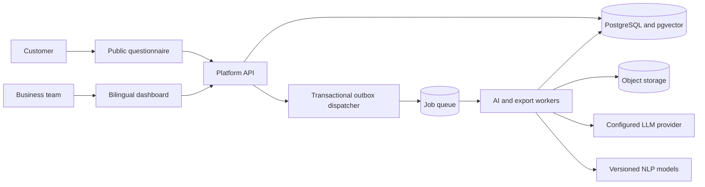

# Architecture

Status: historical platform architecture proposal. The delivered account/business-setup slice uses Node.js/Express and MongoDB; see [decision 0002](decisions/0002-node-mongodb-foundation.md) and [actual backend](backend.md). Python/FastAPI remains the future AI-service boundary. PostgreSQL, pgvector, Redis and the analysis components below are unimplemented proposals.

## Design approach

Start with a modular backend and separately runnable AI workers. Keep tenant authorization, questionnaire collection, analytics, and reporting behind one API rather than splitting them into independently deployed microservices. Slow inference runs asynchronously so customer submissions do not depend on model availability.

Proposed baseline: React with TypeScript for the dashboard, FastAPI for the API, Python/PyTorch and Hugging Face tooling for AI, PostgreSQL with pgvector for structured and vector data, Redis-backed workers for job delivery, and object storage for exports and model artifacts. Select exact versions and providers during implementation and record them in dependency lockfiles and decision records.

## Component flow

The outbox is stored in PostgreSQL. Redis is a delivery mechanism, not the authoritative source of job state.

## Responsibilities and interfaces

| Component | Responsibility | Dependencies |
| --- | --- | --- |
| Dashboard | Forms, score views, filters, reports, localization, RTL | Authenticated API |
| Public collection UI | Render published questionnaire and submit answers | Public token endpoints |
| Identity/tenant module | Resolve identity, membership, and role | Identity provider, database |
| Questionnaire module | Drafts, immutable revisions, public tokens | Database |
| Collection module | Validate and persist submissions; enqueue analysis | Database transaction and outbox |
| Analytics module | Read versioned aggregates with sample counts | Database |
| AI worker | Preprocess, classify, extract aspects, cluster, aggregate | Database, model registry |
| Report worker | Build evidence snapshot, call LLM, validate report | Analytics, LLM, database |
| Export worker | Create filtered redacted artifacts | Database, private object storage |
| Dispatcher | Deliver pending outbox messages with retry | Database, queue |

Contracts are described in [API contracts](api-contracts.md), persistence in [Database](database.md), and scientific processing in [AI pipeline](ai-pipeline.md).

## End-to-end processing

1. An owner publishes an immutable questionnaire revision and receives an opaque public link.
2. The API resolves that token to a workspace and revision. It never accepts a client-selected workspace for public submissions.
3. It validates answers and commits the submission, job record, and outbox event in one transaction.
4. A dispatcher sends the job ID to the queue. Duplicate delivery is expected.
5. A worker reloads tenant-scoped inputs, claims the job, runs the versioned pipeline, and writes outputs idempotently.
6. Aggregate jobs rebuild a scoped snapshot. Readers continue to see the last complete snapshot during processing.
7. Report generation uses that immutable snapshot and redacted evidence. Validation must pass before publication.
8. The dashboard polls job status and shows pending, failed, stale, insufficient-data, and completed states explicitly.

## Tenant and security boundaries

- Authenticated endpoints resolve membership for the workspace in the URL; IDs alone do not authorize access.
- Every tenant-owned relational record carries a workspace ID. Composite foreign keys prevent cross-tenant references.
- Apply PostgreSQL row-level security as defense in depth. Use transaction-local tenant context with pooled connections and a runtime role that cannot bypass RLS.
- Workers derive tenant identity from stored jobs, validate it again, and limit vector retrieval and exports to that workspace.
- Public tokens expose only published questionnaire content. Apply rate limits and body-size limits to submission endpoints.
- Keep provider secrets server-side. Use TLS, private object storage, short-lived download links, and redacted structured logs.
- Treat customer feedback as untrusted data, including instructions embedded in text. LLMs have no unrestricted tools or access to credentials.

## Failure handling

| Failure | Expected behavior |
| --- | --- |
| Queue unavailable | Persisted outbox event remains pending; collection succeeds after database commit |
| Duplicate message or worker restart | Existing job/output keys prevent duplicate analysis; expired leases permit recovery |
| Model or LLM transient error | Bounded exponential backoff, at most three attempts, then visible failure |
| Invalid model output | Record validation failure; preserve raw feedback and do not publish partial results |
| Partial aggregation | Keep last complete snapshot and mark freshness |
| Database unavailable | Return a retryable error; never acknowledge an uncommitted submission |
| Deleted evidence | Mark dependent reports/snapshots stale; deny removed excerpts until regenerated |

## Deployment and observability

Use separate development, staging, and production configuration, databases, storage, and credentials. Production runs API, dispatcher, and workers as separate processes. A dedicated inference worker pool can be introduced when measured GPU or CPU contention requires it.

Log request ID, job ID, workspace ID, stage, duration, and model version without raw customer text. Measure queue age, inference latency, retry/failure rate, dataset coverage, and LLM cost. API liveness must not invoke external models; readiness checks verify required infrastructure.

Maintain database backups and test restoration. Releases pin model, prompt, embedding, and scoring versions. Roll back application code and model routing independently; preserve historical provenance.

## Tradeoffs and future changes

A shared relational/vector database reduces operational overhead but requires careful tenant filters and measured vector-index behavior. Separate vector storage or model serving is a later option driven by observed capacity, not an initial requirement. Redis loss must be recoverable from persistent job and outbox state.

Before implementation, confirm hosting region, identity provider, LLM data policy, retention, and hardware budget. Record approved deviations under `docs/decisions/`.
