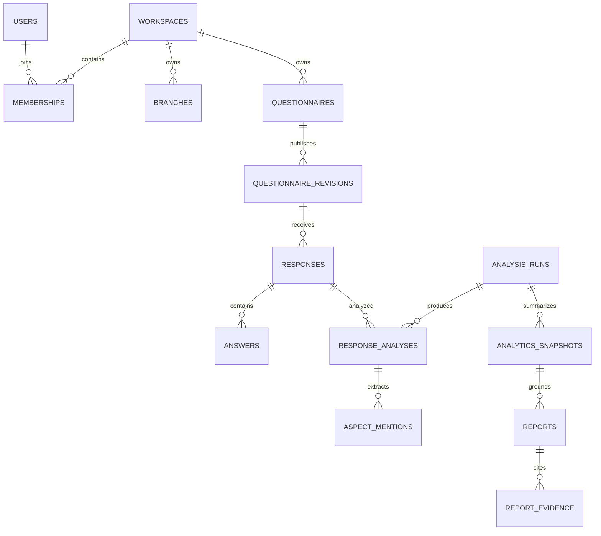

# Database design

Status: logical design, not a migration or deployed schema. PostgreSQL with pgvector is a proposed baseline. Redis only transports jobs; object storage holds private artifacts.

## Identity and tenancy

A workspace represents a business account. Users may belong to several workspaces through memberships. All tenant-owned tables carry `workspace_id`. Public submissions resolve this value server-side from a questionnaire token.

Use UUID primary keys and UTC `timestamptz` timestamps. Add unique constraints on `(workspace_id, id)` for tenant-owned referenced entities. Use composite foreign keys such as `(workspace_id, response_id)` to prevent a record from referencing another tenant's response.

Identity-provider subject is unique on users. Membership is unique on workspace/user and has an active flag and role: owner, analyst, or viewer. Prevent removal of the last active owner.

## Entity map

## Proposed tables

| Table | Core fields and invariants |
| --- | --- |
| users | id, identity_subject, display_name, locale, created_at; no provider password/token storage |
| workspaces | id, name, reporting_timezone, default_locale, retention_policy, created_at |
| memberships | workspace_id, user_id, role, active; unique membership |
| branches | id, workspace_id, name, archived_at |
| questionnaires | id, workspace_id, branch_id nullable, title, draft_definition JSONB, draft_version, active_revision_id, archived_at |
| questionnaire_revisions | id, workspace_id, questionnaire_id, revision_number, definition JSONB, published_at; unique questionnaire/revision number; immutable |
| public_tokens | id, workspace_id, revision_id, token_hash, expires_at, revoked_at; unique cryptographic token hash |
| responses | id, workspace_id, revision_id, branch_id nullable, received_at, processing_status, deleted_at |
| answers | id, workspace_id, response_id, question_id, value JSONB; unique response/question; validate against immutable revision |
| jobs | id, workspace_id, kind, status, attempts, lease_until, input JSONB, result_id, error_code, timestamps |
| outbox_events | id, workspace_id, job_id, event_type, created_at, dispatched_at, attempts |
| idempotency_records | scope_hash, key, request_hash, result_reference, expires_at; unique scope/key |
| model_versions | id, task, artifact_uri, artifact_digest, config JSONB, dataset_version, created_at |
| analysis_runs | id, workspace_id, filters JSONB, pipeline_version, model_version_ids, scoring_version, cutoff_at, status |
| analysis_run_inputs | workspace_id, run_id, response_id; unique run/response; immutable captured membership |
| response_analyses | id, workspace_id, run_id, response_id, sentiment, language, confidence, exclusion_reason; unique run/response |
| sentence_analyses | id, workspace_id, response_analysis_id, answer_id, sentence_index, redacted_text, sentiment, offsets |
| aspects | id, workspace_id, canonical_key, labels JSONB, taxonomy_version; unique workspace/key/version |
| aspect_mentions | id, workspace_id, sentence_analysis_id, aspect_id, polarity, confidence, source_span |
| embeddings | id, workspace_id, sentence_analysis_id, model_version_id, vector, redaction_version; unique sentence/model |
| topic_clusters | id, workspace_id, run_id, label, representative_sentence_id, response_count, sentence_count |
| cluster_members | workspace_id, cluster_id, sentence_analysis_id; unique cluster/sentence |
| analytics_snapshots | id, workspace_id, run_id, filters JSONB, timezone, metrics JSONB, scoring_version, as_of, stale_at |
| reports | id, workspace_id, snapshot_id, locale, status, content JSONB, prompt_version, model_version, generated_at, invalidated_at |
| report_evidence | id, workspace_id, report_id, response_id, sentence_analysis_id, redacted_excerpt, claim_key |
| exports | id, workspace_id, requested_by, kind, filters JSONB, object_key, status, expires_at |
| audit_events | id, workspace_id, actor_id nullable, action, resource_type, resource_id, request_id, created_at; no raw text |

Model metadata may be global and read-only to tenant roles. Every output still records its workspace. Exact column types and relationship constraints must be formalized in reviewed migrations.

## Data interpretation

Questionnaire definitions and answer values use JSONB because field types differ. Validation belongs in the API and worker; JSONB is not a substitute for referential integrity. Keep frequently filtered fields such as tenant, branch, status, and received time as typed columns.

Sentence offsets point into the normalized/redacted representation identified by its version, not implicitly into the original text. Store the mapping needed to reconstruct provenance without publishing private source text.

Use checks for legal job states, sentiment labels, confidence in [0,1], score in [0,10], and nonnegative counts. A missing score is null. Every snapshot contains results from one scoring version and one captured input set.

## Transactions and consistency

- Submission transaction writes response, answers, queued job, idempotency record, and outbox event together.
- Job claim uses a lock or atomic state transition and a bounded lease. Recovery requeues expired leases.
- Workers upsert by stable run/response keys. Output writes and final job status commit together where feasible.
- Aggregation publishes a new complete snapshot atomically. Never expose half-written aggregates.
- Report state becomes ready only after schema and evidence validation.
- Publication locks/checks the draft version, inserts an immutable revision, then activates its token.

## Indexing and vectors

Start with B-tree indexes for workspace/time, workspace/status, foreign-key columns, active memberships, and undispatched outbox entries. Add indexes based on real query plans.

Embedding dimension depends on the selected model and must be fixed for each vector column or versioned table. Never mix incompatible embedding spaces. Candidate retrieval always applies tenant filters and model version; tests must verify isolation even when vector indexes are enabled.

Use cosine similarity if supported by the chosen embeddings and record the normalization method. Decide exact vector index configuration after measuring corpus size and retrieval quality.

## Retention and deletion

Retention periods require owner approval before real data collection. Until approved, use synthetic data in development and staging.

A delete request first hides the response and its evidence, invalidates affected reports/snapshots, and queues purge. Purge removes answers, sentence copies, mentions, vectors, report excerpts, and exports that contain the response, then rebuilds affected aggregates/clusters. Ensure stored outbox/job inputs contain IDs rather than raw text.

Backups retain deleted data until their approved expiry; restore procedures reapply deletion records before serving restored data. Retain only minimal authorized audit metadata without customer content. Explain this boundary in the eventual privacy notice.

## Migration and recovery strategy

Introduce numbered, reviewed migrations with the first backend code. Prefer expand/migrate/contract changes to support rolling releases. Backfill large tables in bounded jobs; avoid destructive migrations during deployment without backup and rollback planning.

Production runtime roles must not own tables or bypass tenant RLS. Migration and backup credentials stay separate. Test tenant policies, constraints, migration upgrade paths, and restoration using synthetic data before release.
