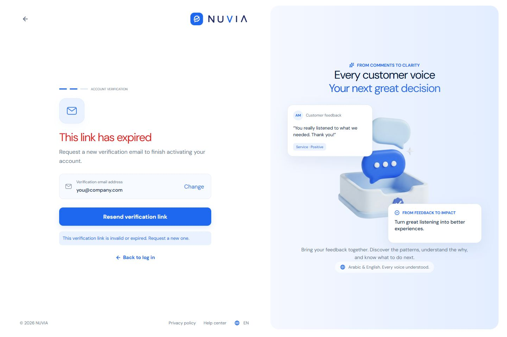

# Desktop - English

Viewport: 1440 x 960. Full-page screenshots.

## Analytics Aspects

## Analytics Comparison

## Analytics Sentiment

## Analytics Topics

## Analytics Trends

## Business Error

## Business Information

## Business Setup

## Dashboard Empty

## Dashboard

## Feedback Details 1248

## Feedbacks Empty

## Feedbacks Loading

## Feedbacks No Results

## Feedbacks

## Forgot

## Get Started

## Landing

## Login

## Nuvia Assistant

## Report Details August

## Report Details Cairo

## Report Details Service

## Report Details

## Reports

## Reset

## Signup

## Survey Ai Review

## Survey Ai

## Survey All

## Survey Choices

## Survey Closed

## Survey Create

## Survey Drafts

## Survey Edit

## Survey Empty

## Survey Live

## Survey Paused

## Survey Questions

## Survey Results

## Survey Share

## Verify Email Expired

## Verify Email Verified

## Verify Email

