# Mobile — Arabic

[Back to screenshot index](README.md)

Screens appear in the same product-flow order in every gallery.

## 1. Landing Page

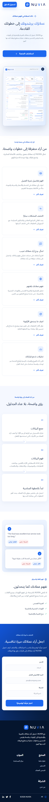

## 2. Login

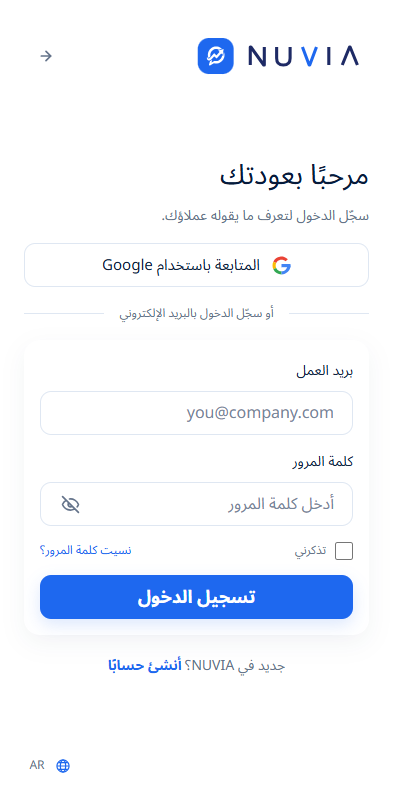

## 3. Sign Up

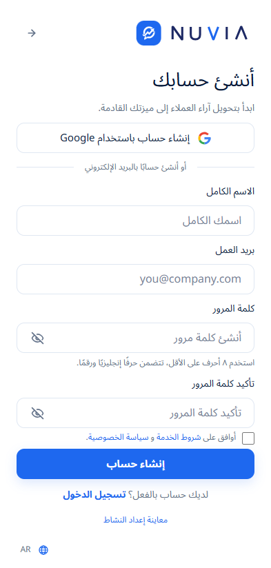

## 4. Forgot Password

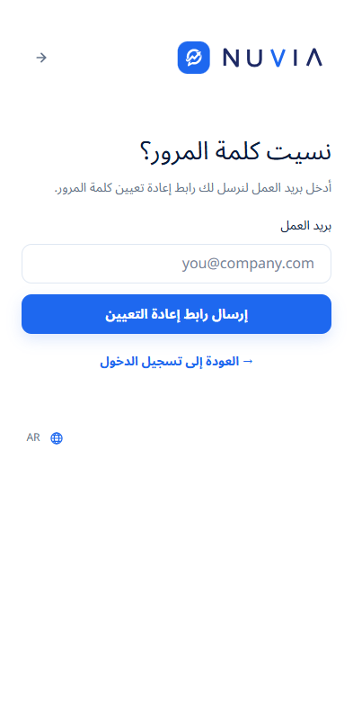

## 5. Reset Password

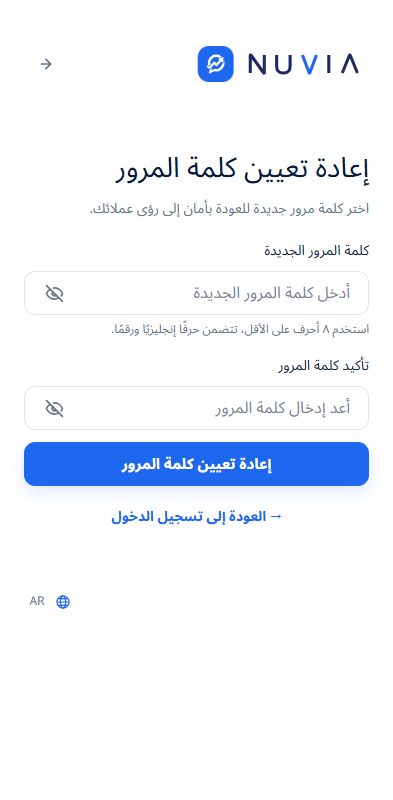

## 6. Business Information

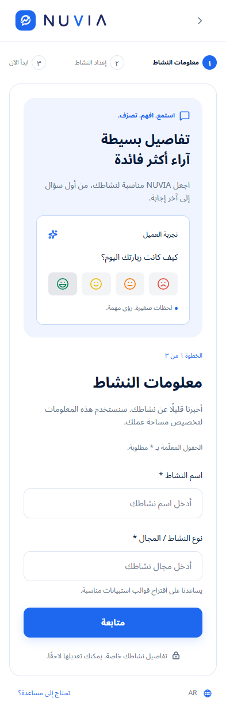

## 7. Business Information — Error State

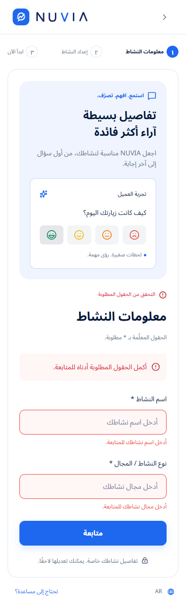

## 8. Business Setup

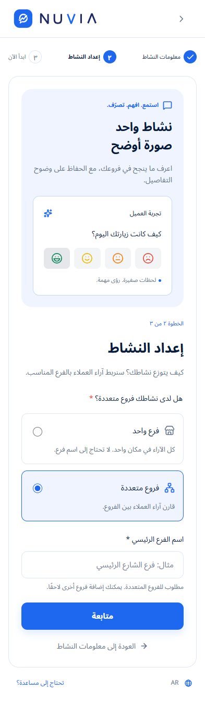

## 9. Get Started

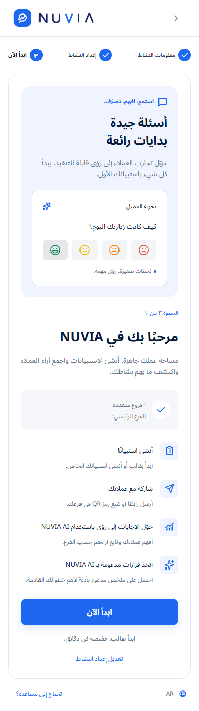

## 10. Overview

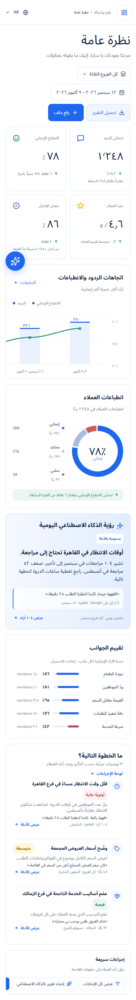

## 11. Overview — Empty State

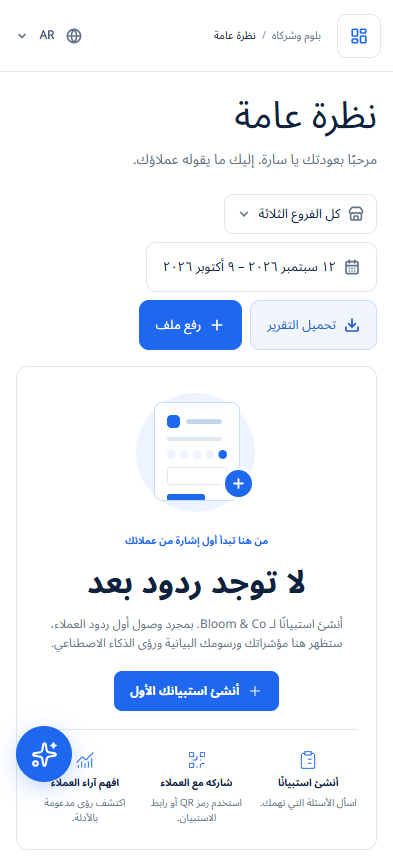

## 12. Feedback

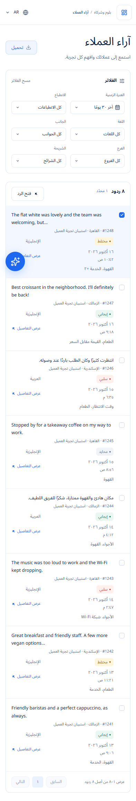

## 13. Feedback — Empty State

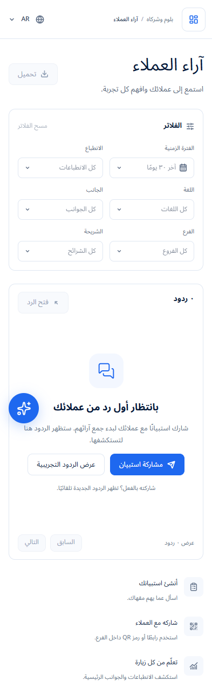

## 14. Feedback Details

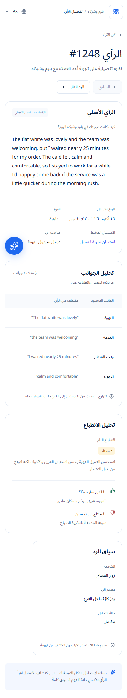

## Additional state — AI Assistant

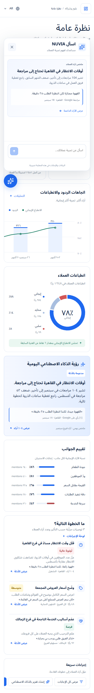
