# Mobile — AR

[Browse by section](screens/README.md). Synthetic preview data; account services are tested separately.

## analytics-sentiment

## analytics-aspects

## analytics-topics

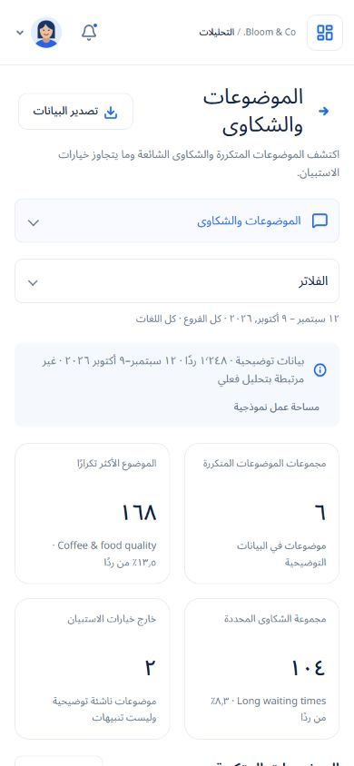

## analytics-trends

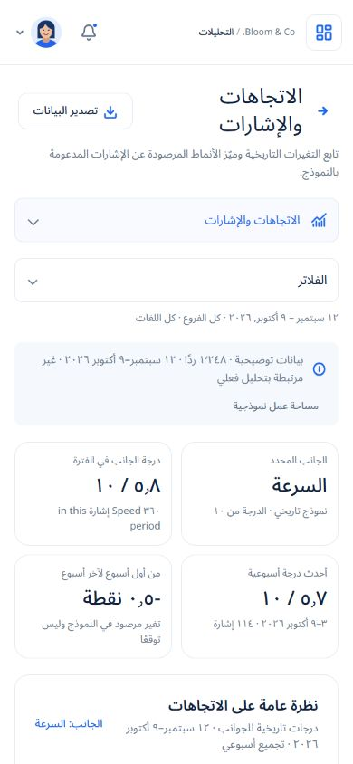

## analytics-comparison

## nuvia-assistant

## reports

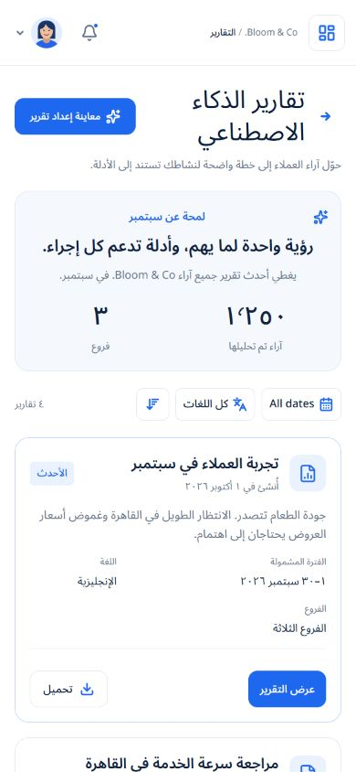

## report-details

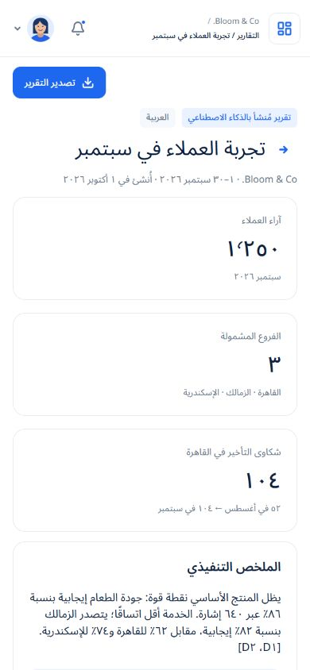

## report-details?id=cairo

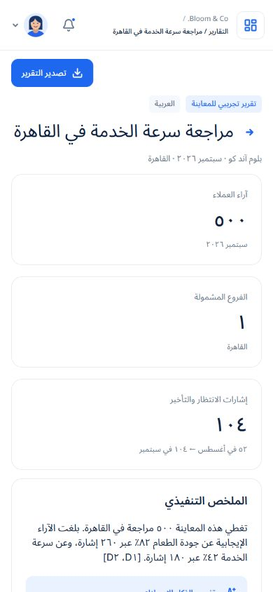

## report-details?id=service

## report-details?id=august

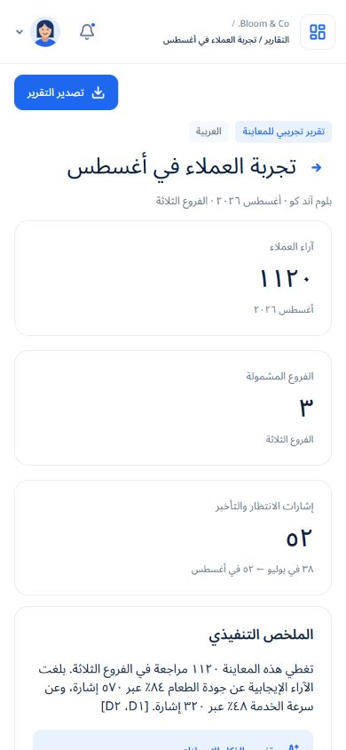

## feedbacks-loading

## feedbacks-no-results

## survey-all

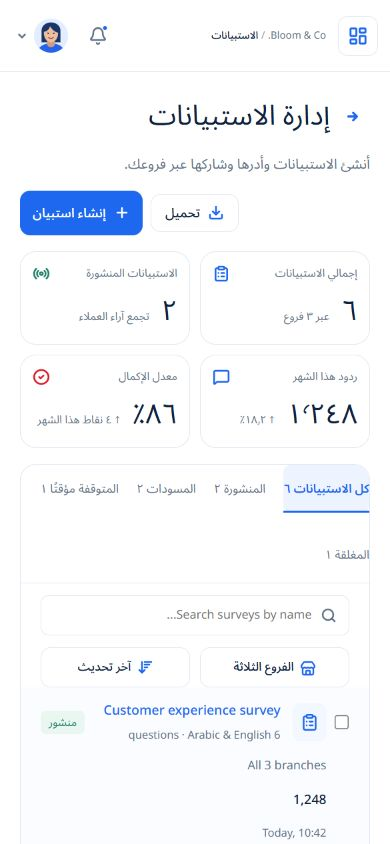

## survey-empty

## survey-live

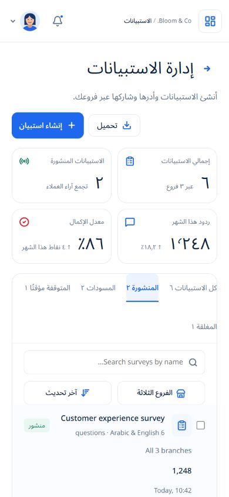

## survey-drafts

## survey-paused

## survey-closed

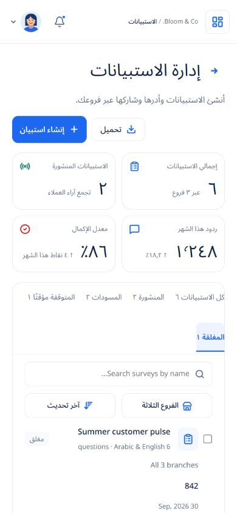

## survey-create

## survey-questions

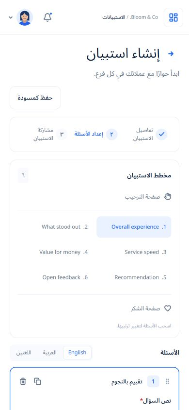

## survey-choices

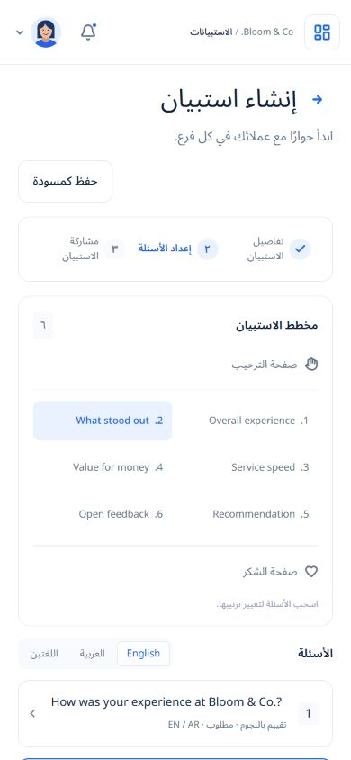

## survey-edit

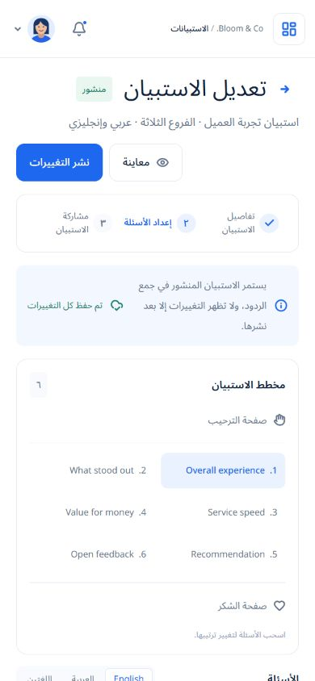

## survey-share

## survey-ai

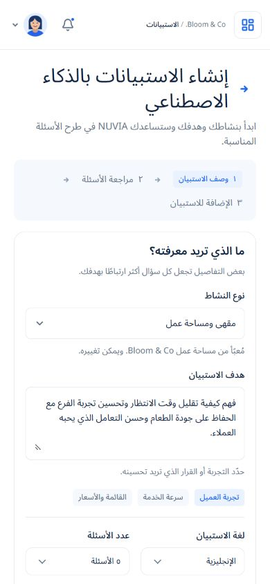

## survey-ai-review

## survey-results

## landing

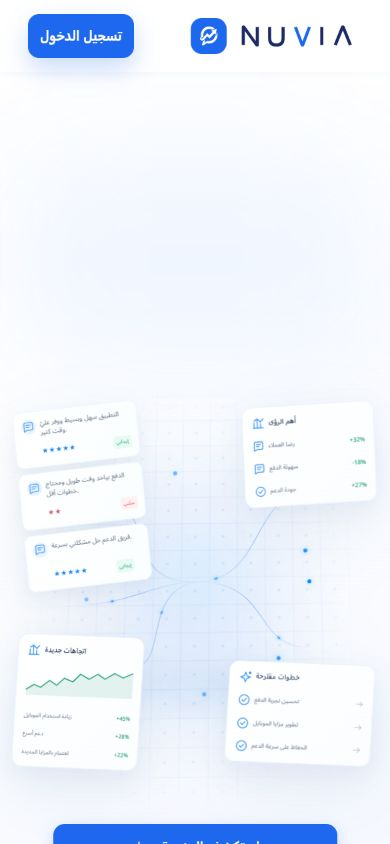

## dashboard

## dashboard-empty

## feedbacks

## feedbacks-empty

## feedback-details?id=1248

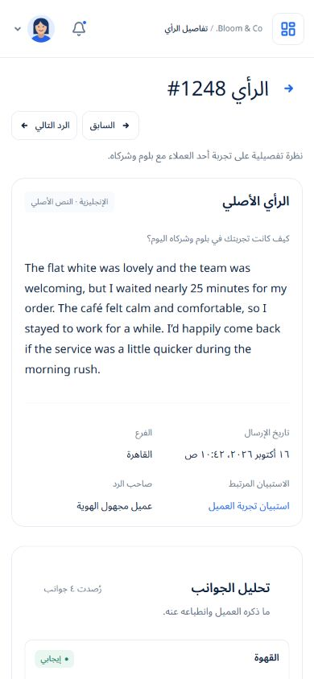

## login

## signup

## forgot

## reset

## verify-email

## verify-email-expired

## verify-email-verified

## business-information

## business-error

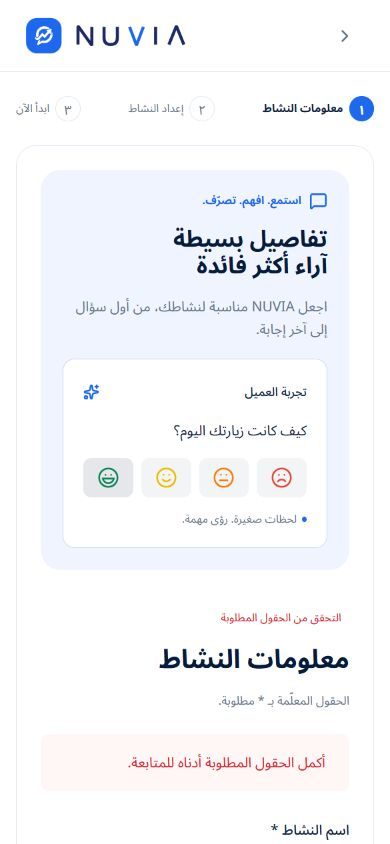

## business-setup

## get-started

## business

## business-edit

## business-add

## branches

## branch-add

## branch-edit

## branch-history

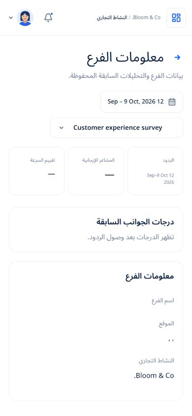

## settings

## settings-personal

## settings-account

## settings-profile

## settings-language

## settings-security

## settings-password

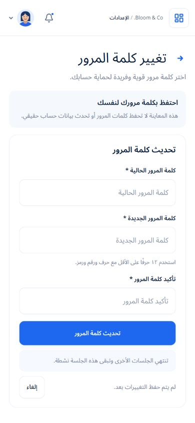

## settings-two-factor

## settings-email

## settings-devices

## settings-notifications

## settings-notifications-email

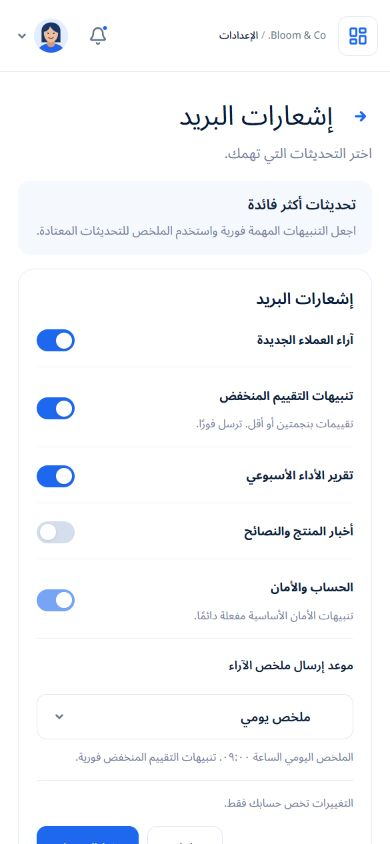

## settings-notifications-inapp

## notifications

## subscription

## customer-feedback

## analytics-sentiment — empty

## reports — empty

## branches — empty

