# Phone - Arabic

Viewport: 390 x 844. Full-page screenshots.

## Analytics Aspects

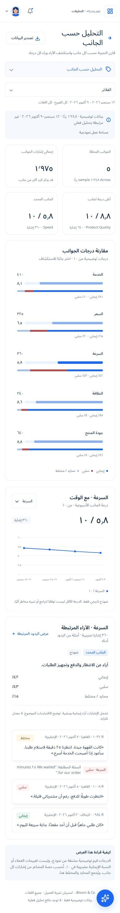

## Analytics Comparison

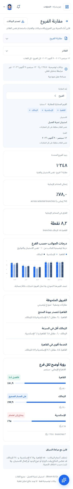

## Analytics Sentiment

## Analytics Topics

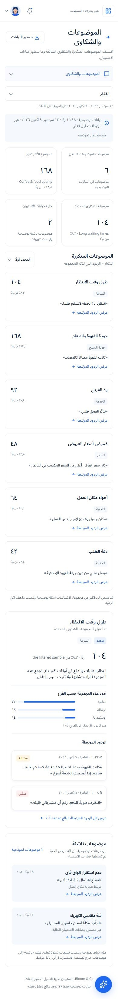

## Analytics Trends

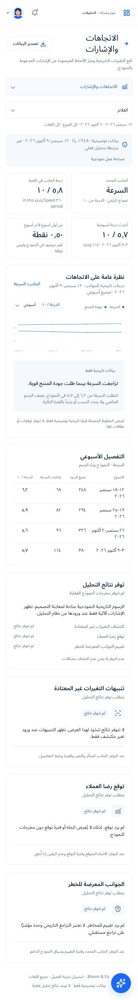

## Business Error

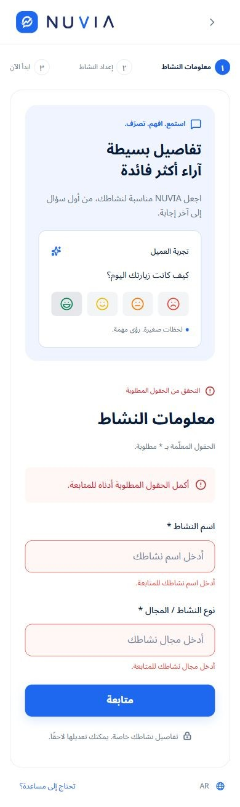

## Business Information

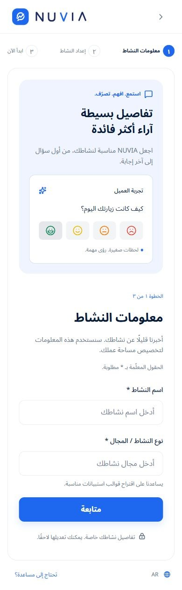

## Business Setup

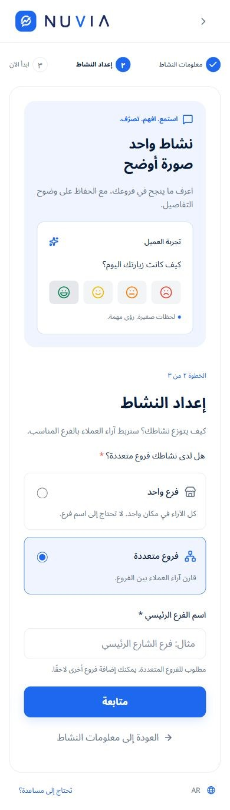

## Dashboard Empty

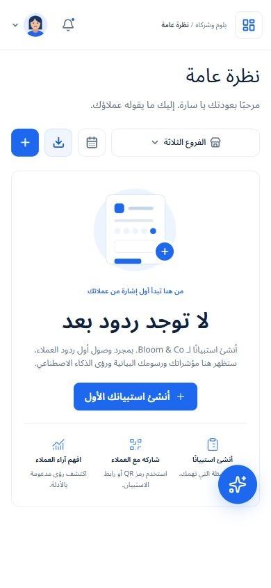

## Dashboard

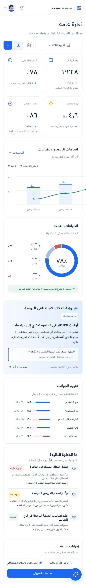

## Feedback Details 1248

## Feedbacks Empty

## Feedbacks Loading

## Feedbacks No Results

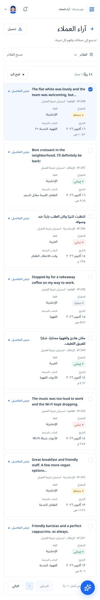

## Feedbacks

## Forgot

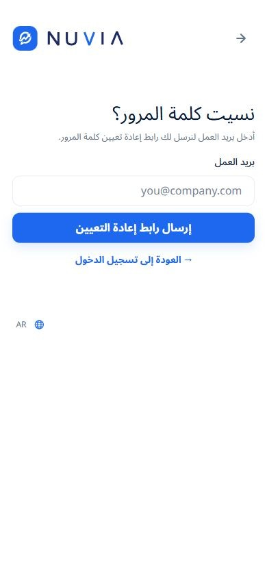

## Get Started

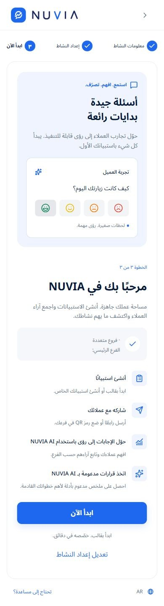

## Landing

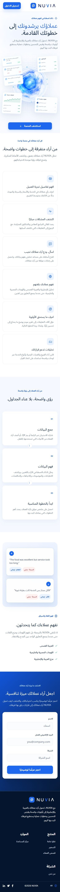

## Login

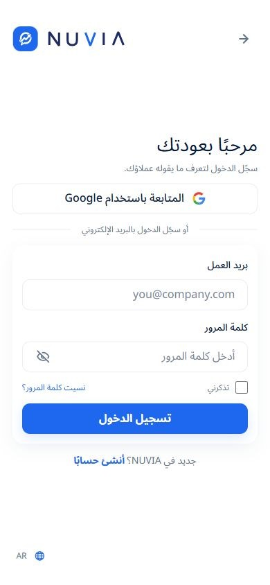

## Nuvia Assistant

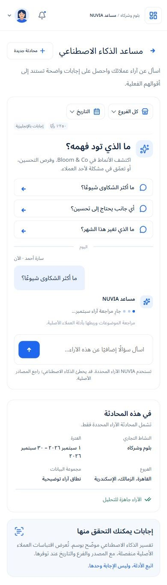

## Report Details August

## Report Details Cairo

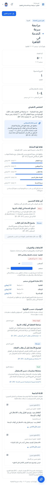

## Report Details Service

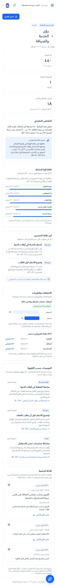

## Report Details

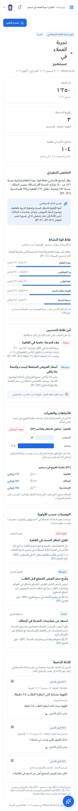

## Reports

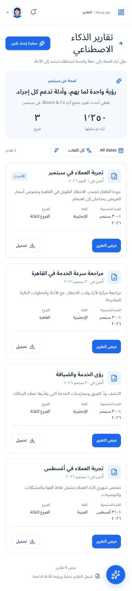

## Reset

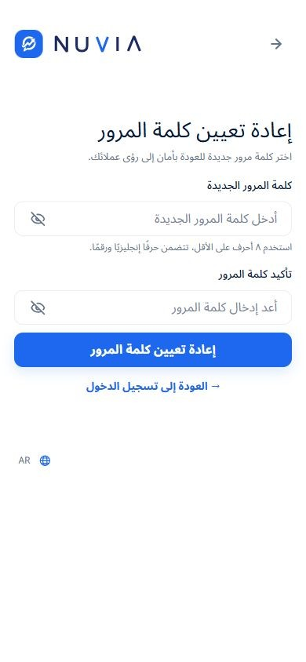

## Signup

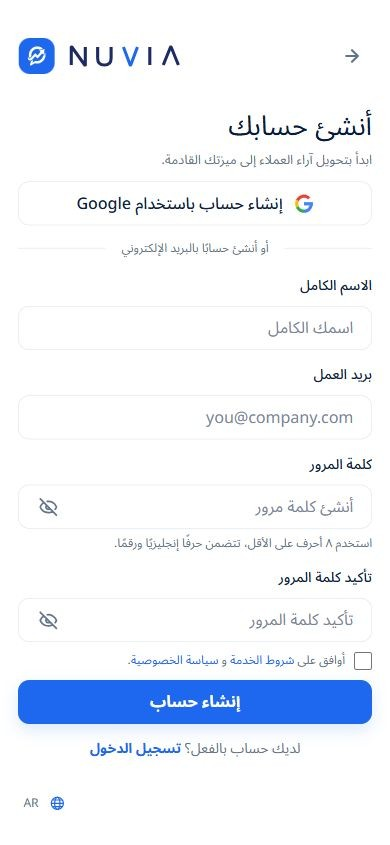

## Survey Ai Review

## Survey Ai

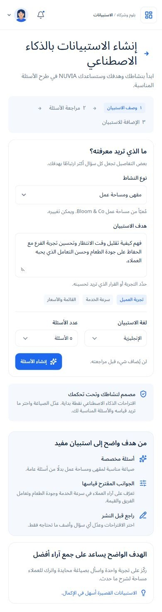

## Survey All

## Survey Choices

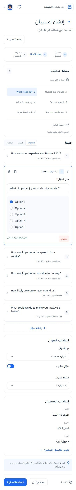

## Survey Closed

## Survey Create

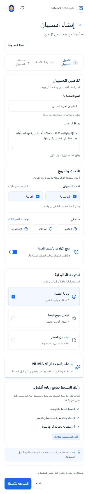

## Survey Drafts

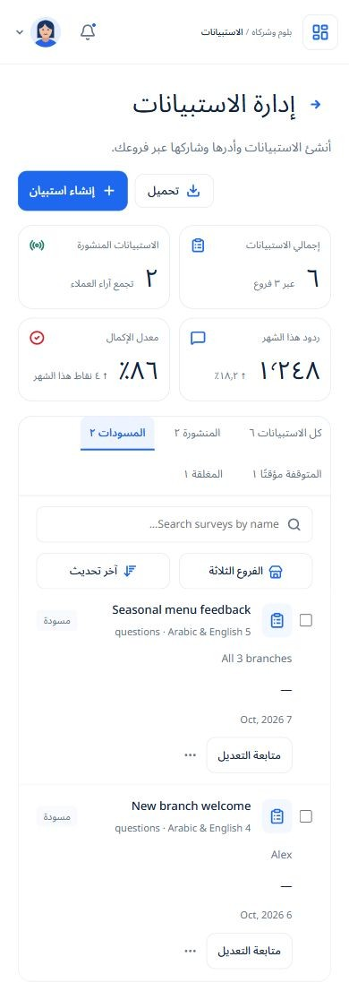

## Survey Edit

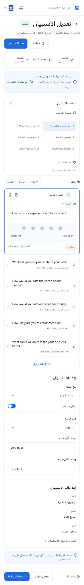

## Survey Empty

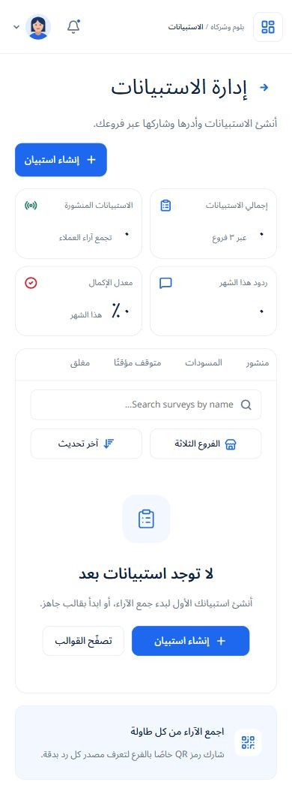

## Survey Live

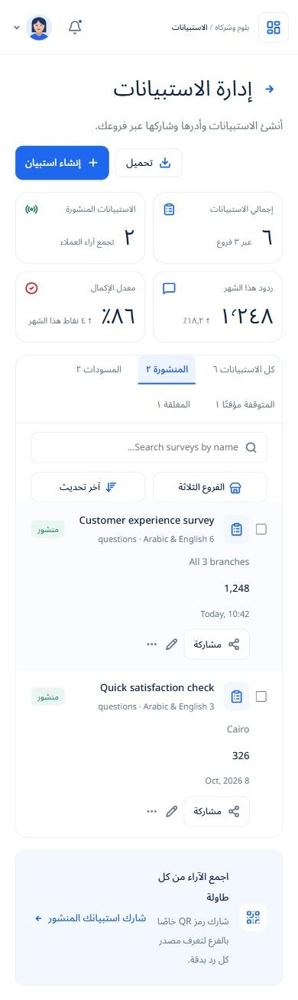

## Survey Paused

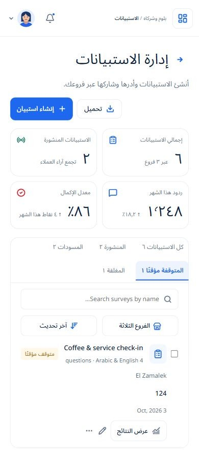

## Survey Questions

## Survey Results

## Survey Share

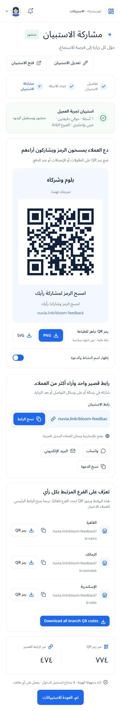

## Verify Email

