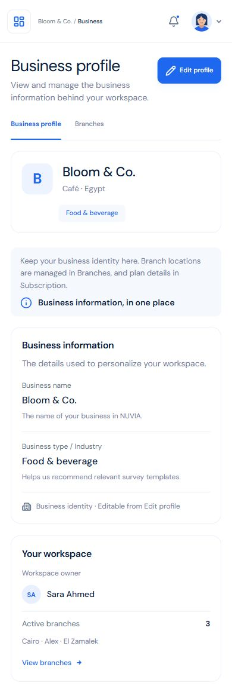
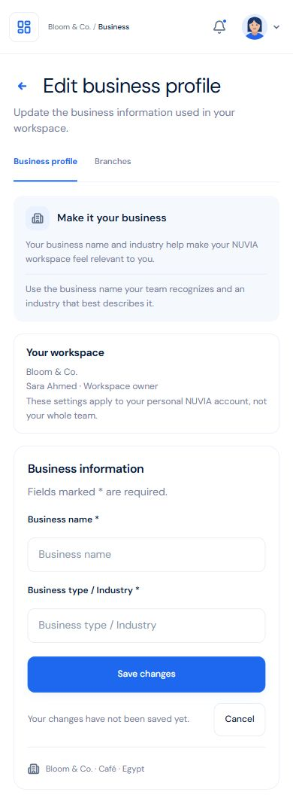
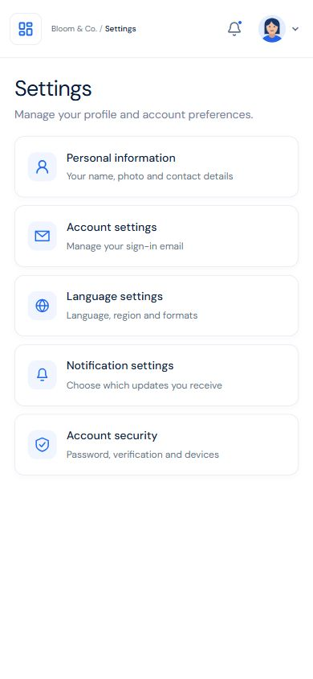
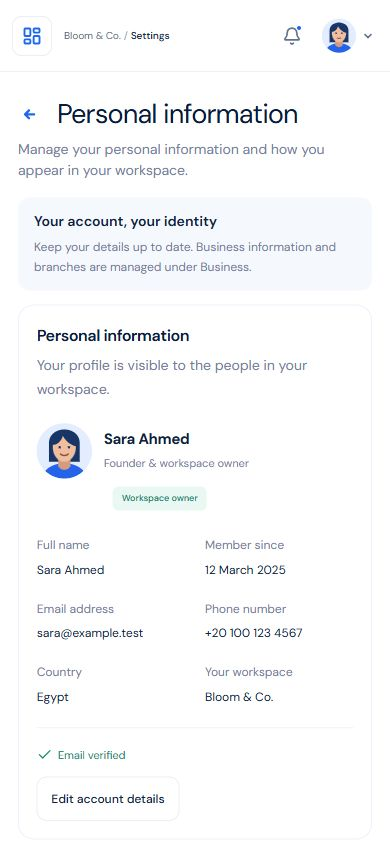
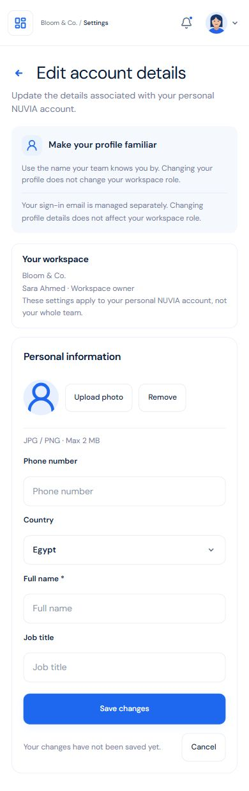
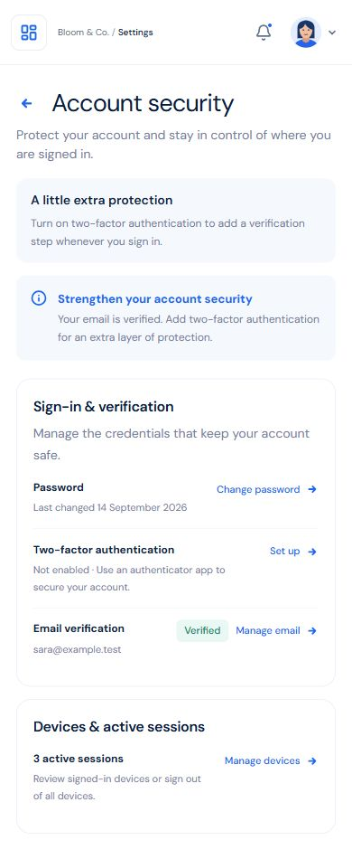
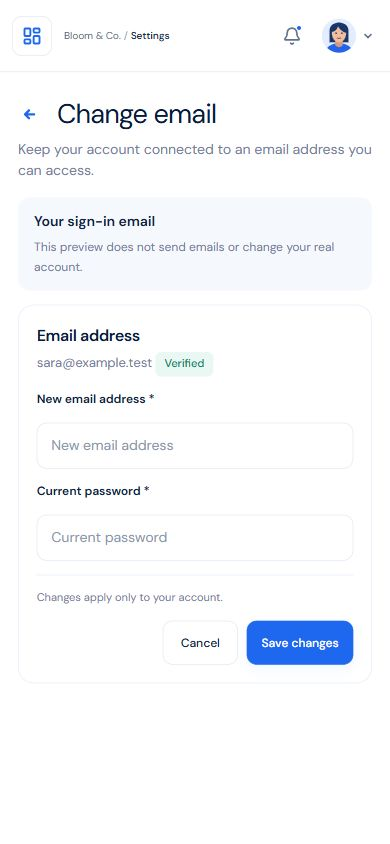
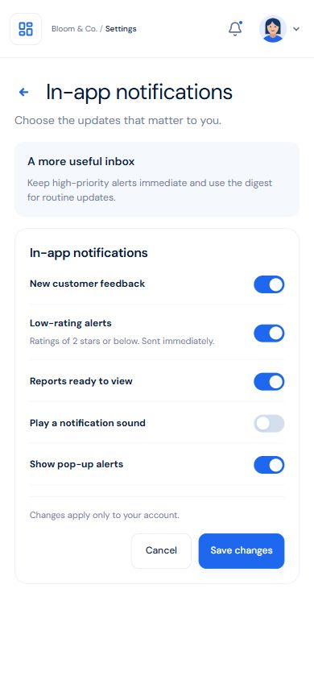

# Mobile — EN

Synthetic preview data. Account services are tested separately.

## analytics-sentiment

## analytics-aspects

## analytics-topics

## analytics-trends

## analytics-comparison

## nuvia-assistant

## reports

## report-details

## report-details?id=cairo

## report-details?id=service

## report-details?id=august

## feedbacks-loading

## feedbacks-no-results

## survey-all

## survey-empty

## survey-live

## survey-drafts

## survey-paused

## survey-closed

## survey-create

## survey-questions

## survey-choices

## survey-edit

## survey-share

## survey-ai

## survey-ai-review

## survey-results

## landing

## dashboard

## dashboard-empty

## feedbacks

## feedbacks-empty

## feedback-details?id=1248

## login

## signup

## forgot

## reset

## verify-email

## verify-email-expired

## verify-email-verified

## business-information

## business-error

## business-setup

## get-started

## business

## business-edit

## business-add

## branches

## branch-add

## branch-edit

## branch-history

## settings

## settings-personal

## settings-account

## settings-profile

## settings-language

## settings-security

## settings-password

## settings-two-factor

## settings-email

## settings-devices

## settings-notifications

## settings-notifications-email

## settings-notifications-inapp

## notifications

## subscription

## customer-feedback

## analytics-sentiment — empty

## reports — empty

## branches — empty

