# Phone - English

Viewport: 390 x 844. Full-page screenshots.

## Analytics Aspects

## Analytics Comparison

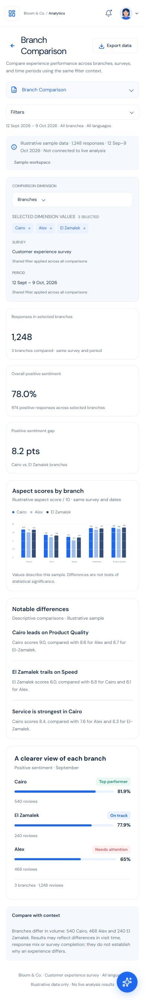

## Analytics Sentiment

## Analytics Topics

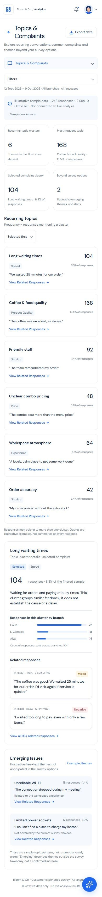

## Analytics Trends

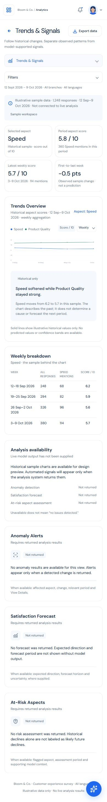

## Business Error

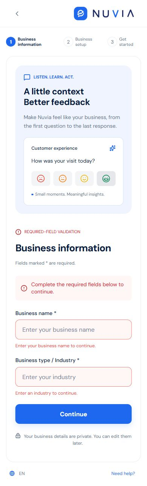

## Business Information

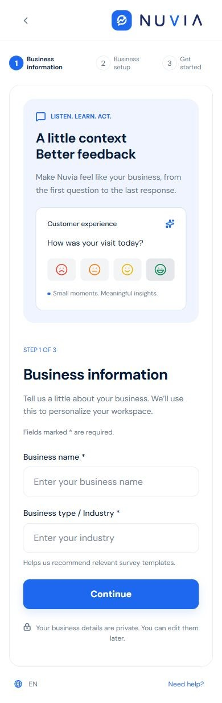

## Business Setup

## Dashboard Empty

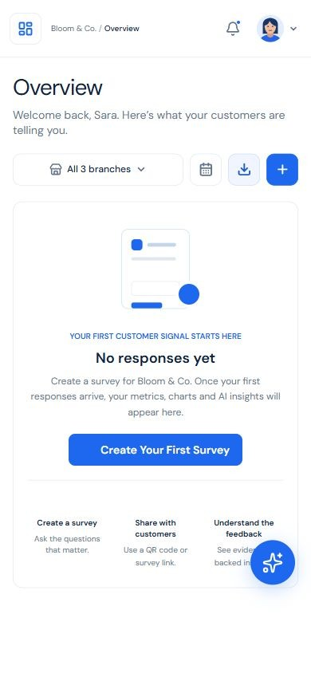

## Dashboard

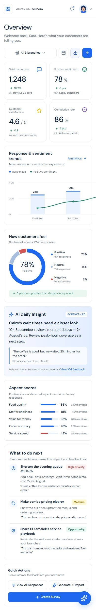

## Feedback Details 1248

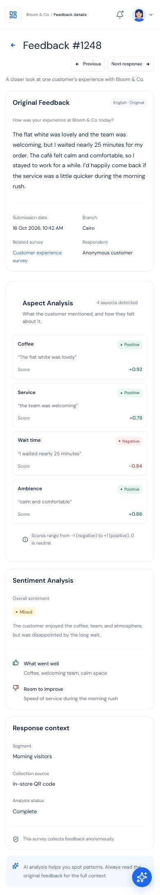

## Feedbacks Empty

## Feedbacks Loading

## Feedbacks No Results

## Feedbacks

## Forgot

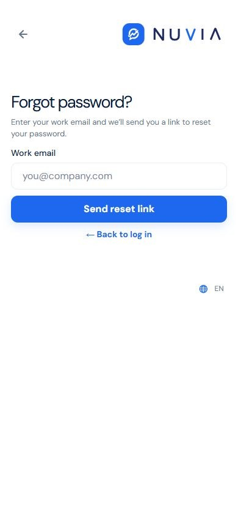

## Get Started

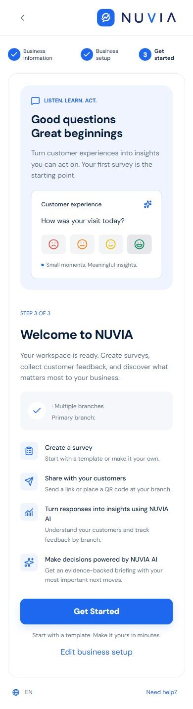

## Landing

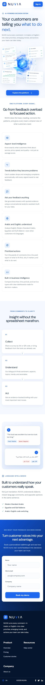

## Login

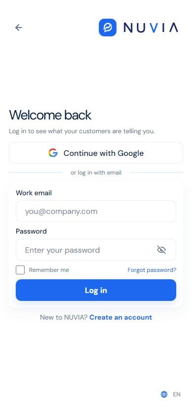

## Nuvia Assistant

## Report Details August

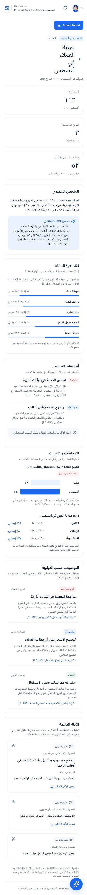

## Report Details Cairo

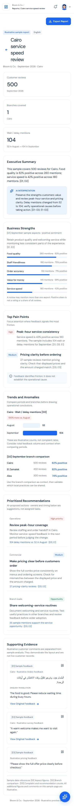

## Report Details Service

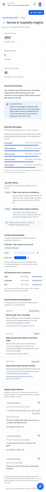

## Report Details

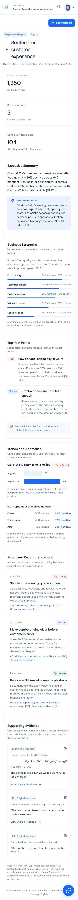

## Reports

## Reset

## Signup

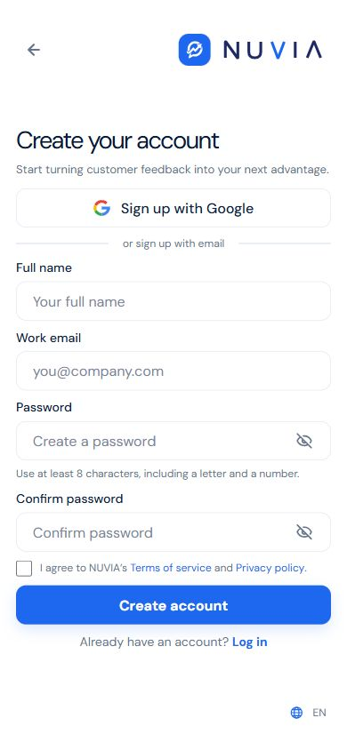

## Survey Ai Review

## Survey Ai

## Survey All

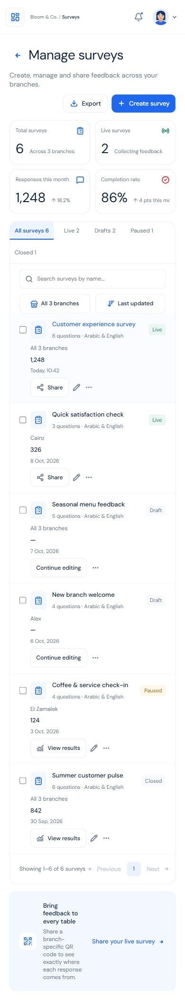

## Survey Choices

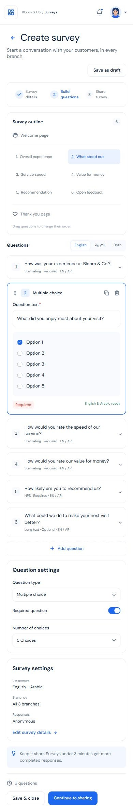

## Survey Closed

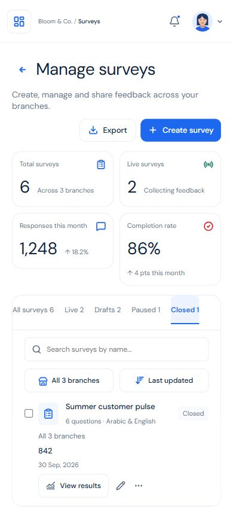

## Survey Create

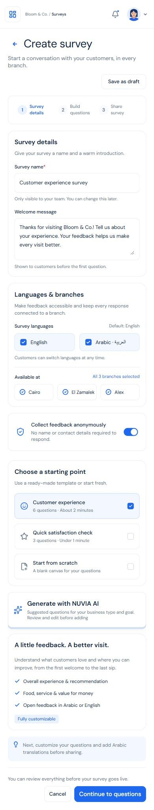

## Survey Drafts

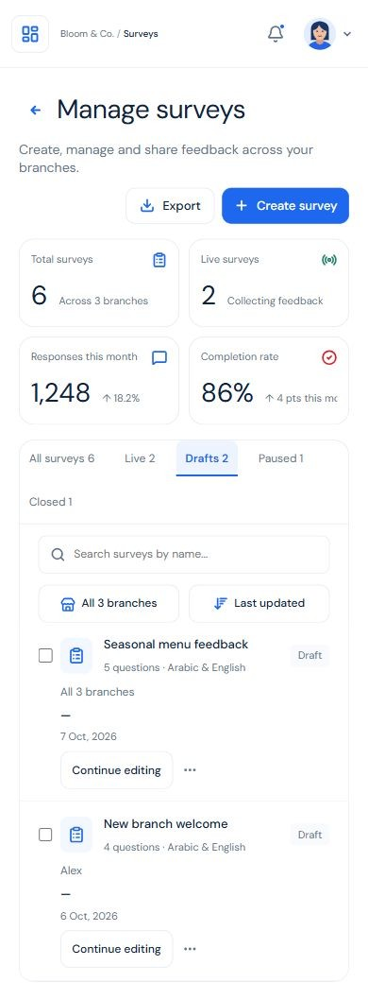

## Survey Edit

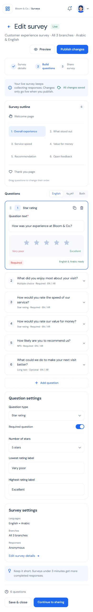

## Survey Empty

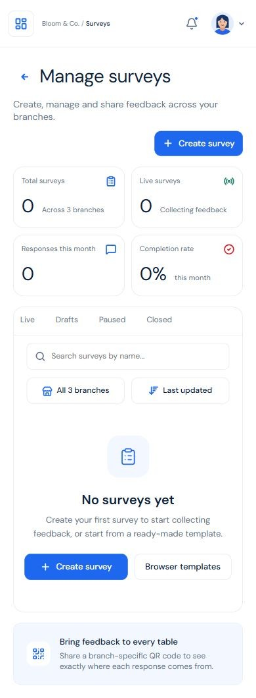

## Survey Live

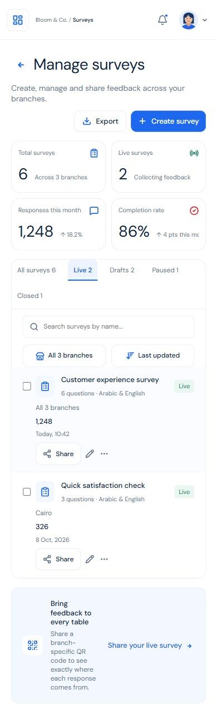

## Survey Paused

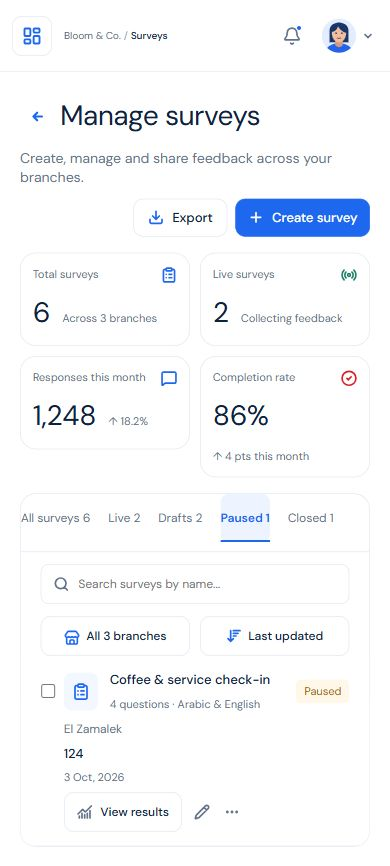

## Survey Questions

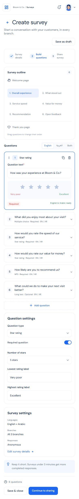

## Survey Results

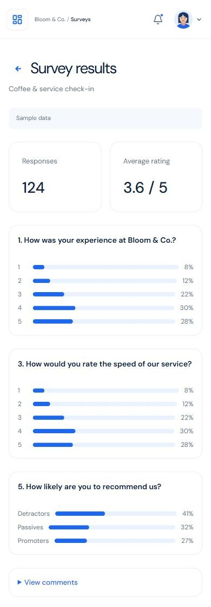

## Survey Share

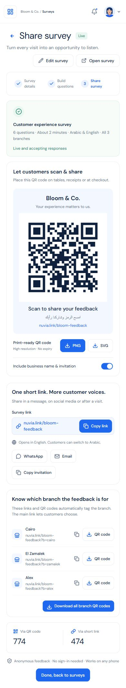

## Verify Email Expired

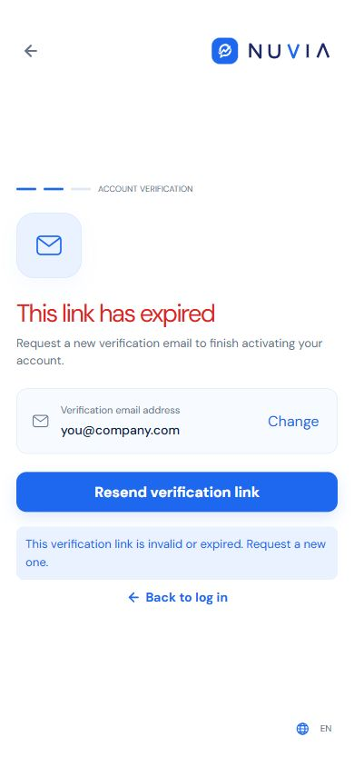

## Verify Email Verified

## Verify Email

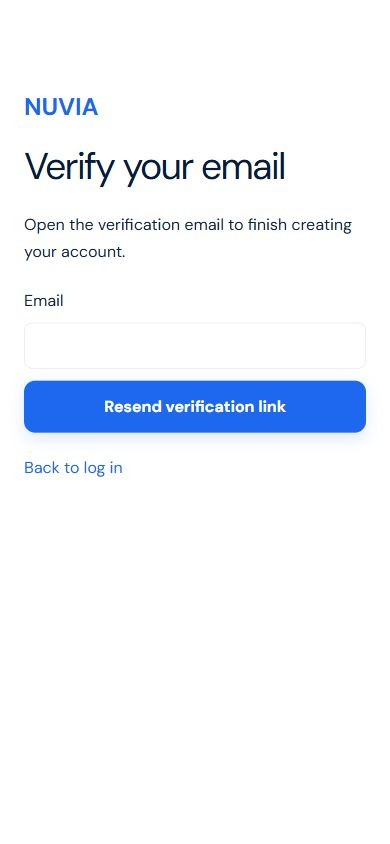
