# Mobile — EN

[Browse by section](screens/README.md). Synthetic preview data; account services are tested separately.

## analytics-sentiment

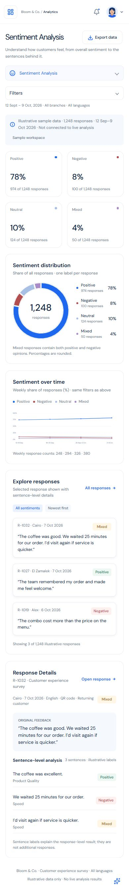

## analytics-aspects

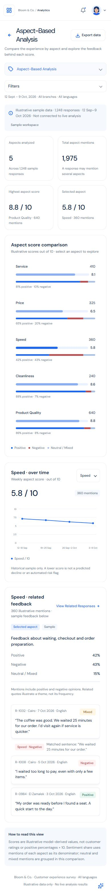

## analytics-topics

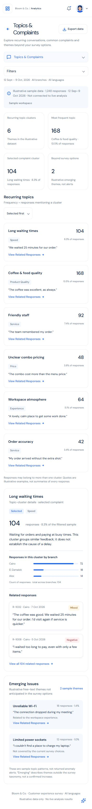

## analytics-trends

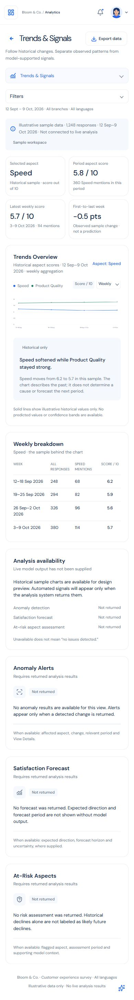

## analytics-comparison

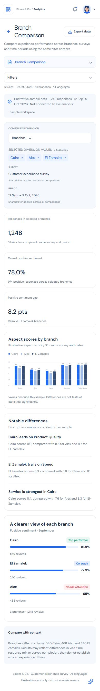

## nuvia-assistant

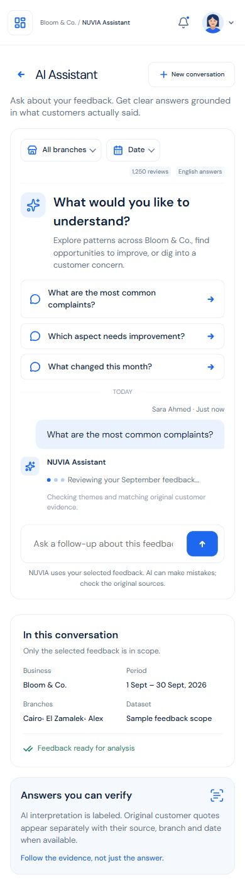

## reports

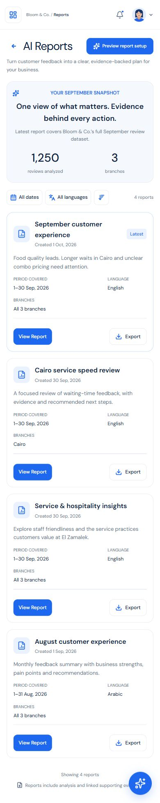

## report-details

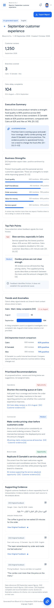

## report-details?id=cairo

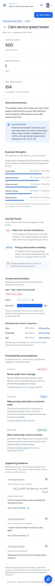

## report-details?id=service

## report-details?id=august

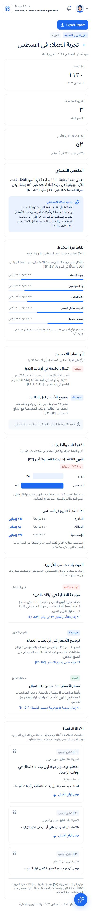

## feedbacks-loading

## feedbacks-no-results

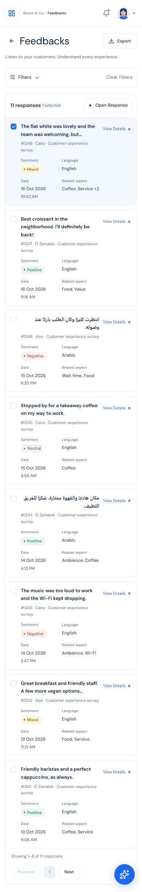

## survey-all

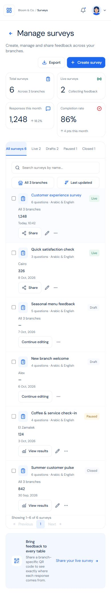

## survey-empty

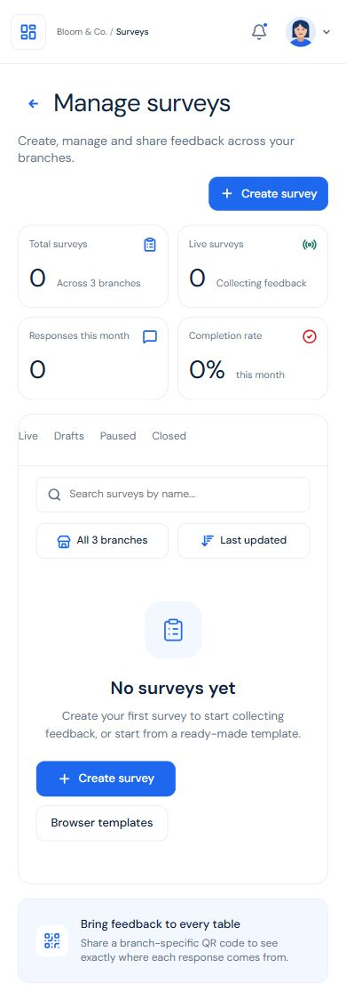

## survey-live

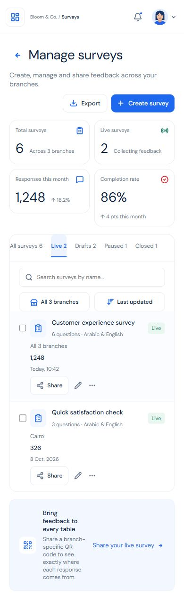

## survey-drafts

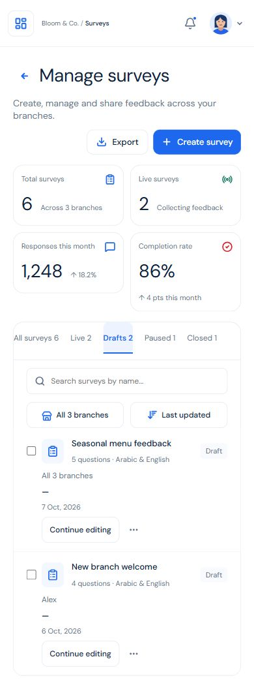

## survey-paused

## survey-closed

## survey-create

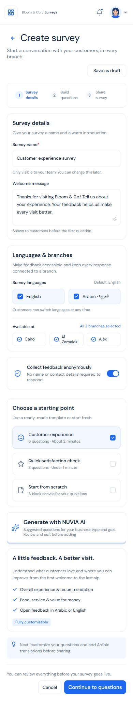

## survey-questions

## survey-choices

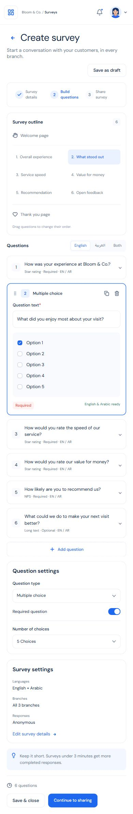

## survey-edit

## survey-share

## survey-ai

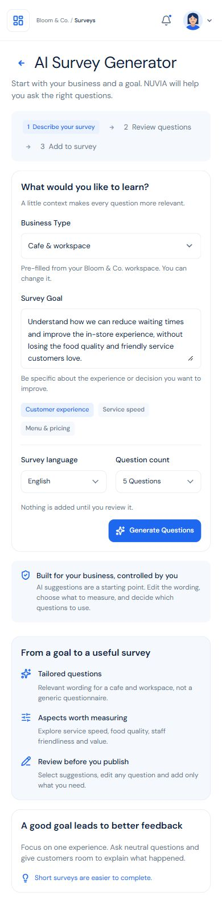

## survey-ai-review

## survey-results

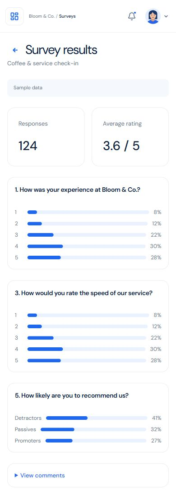

## landing

## dashboard

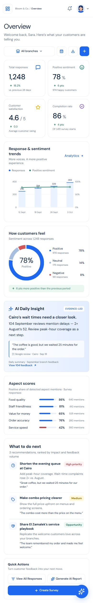

## dashboard-empty

## feedbacks

## feedbacks-empty

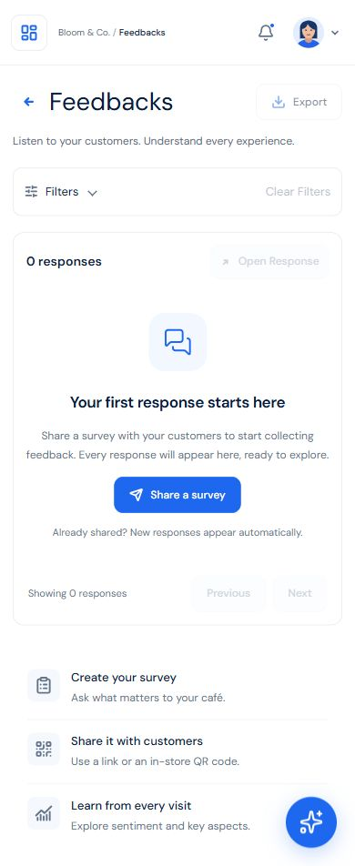

## feedback-details?id=1248

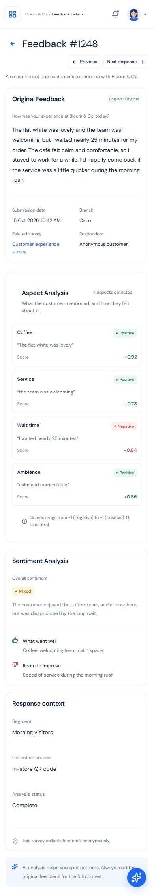

## login

## signup

## forgot

## reset

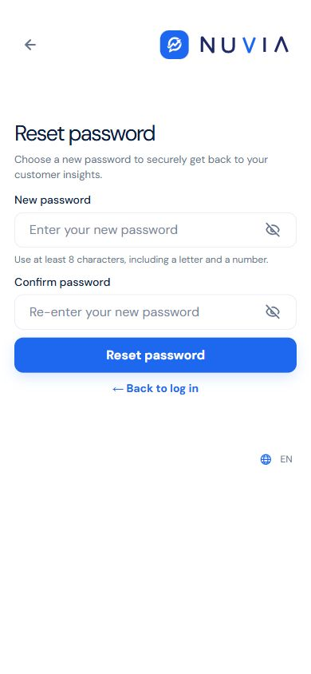

## verify-email

## verify-email-expired

## verify-email-verified

## business-information

## business-error

## business-setup

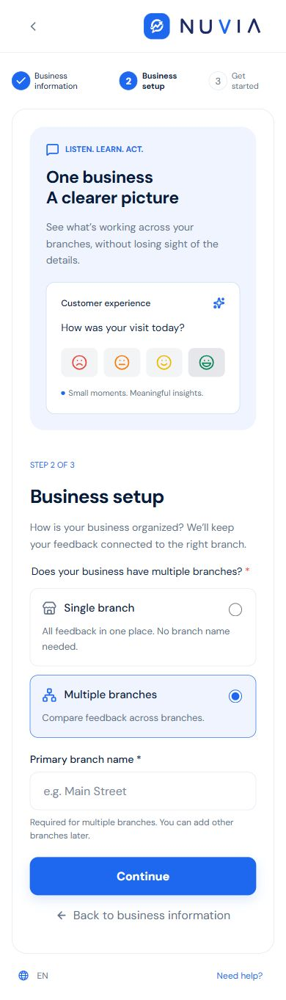

## get-started

## business

## business-edit

## business-add

## branches

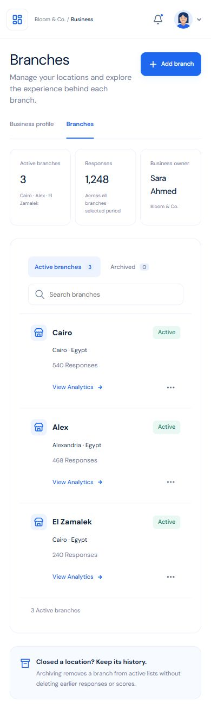

## branch-add

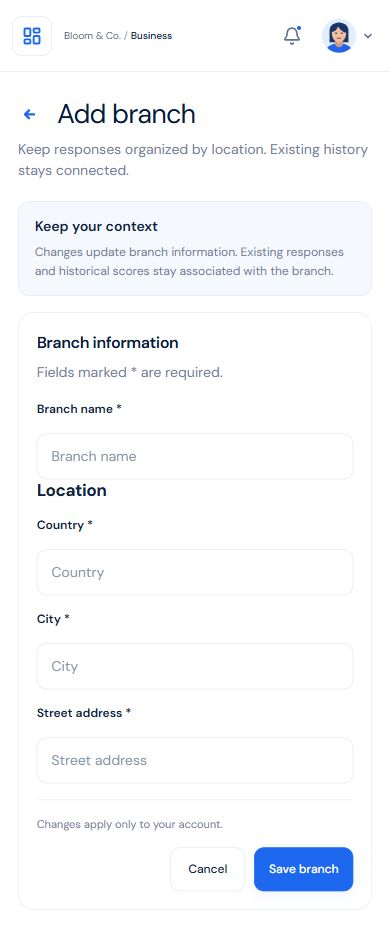

## branch-edit

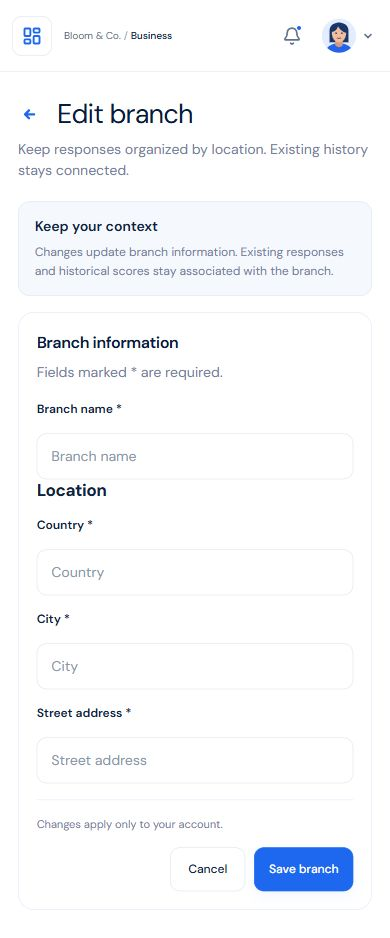

## branch-history

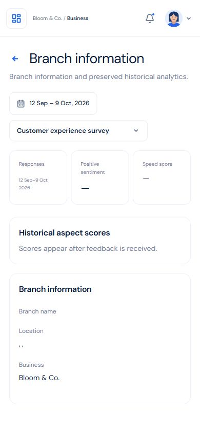

## settings

## settings-personal

## settings-account

## settings-profile

## settings-language

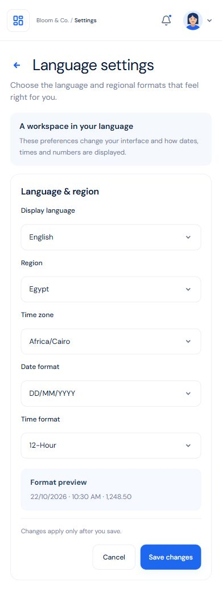

## settings-security

## settings-password

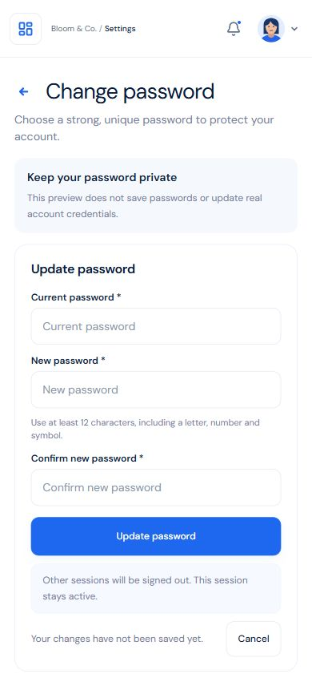

## settings-two-factor

## settings-email

## settings-devices

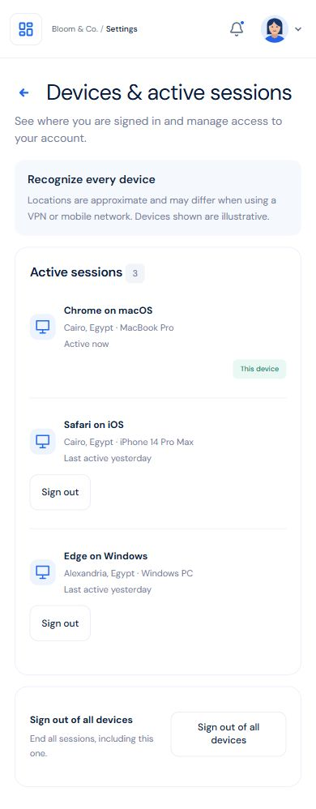

## settings-notifications

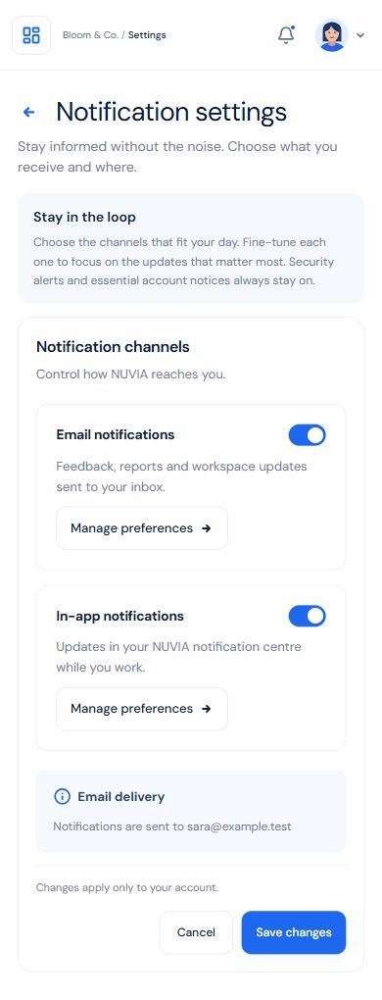

## settings-notifications-email

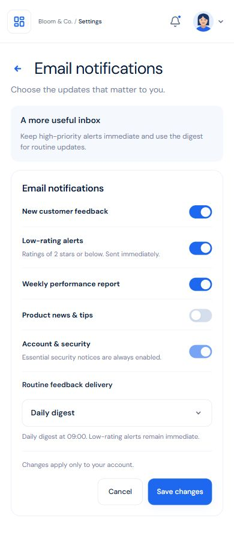

## settings-notifications-inapp

## notifications

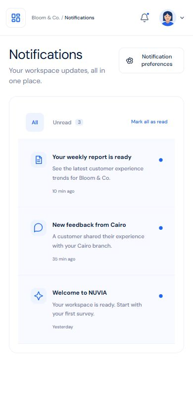

## subscription

## customer-feedback

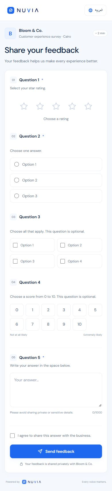

## analytics-sentiment — empty

## reports — empty

## branches — empty

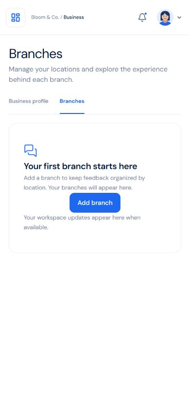
